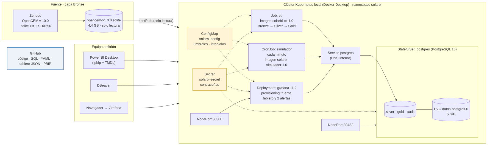

# SolarBI · Balance energético de una microrred híbrida (solar + batería + red)

> *From inverter telemetry to actionable insights: a containerized, Kubernetes-orchestrated BI pipeline for a hybrid microgrid.*

Solución de Inteligencia de Negocios de extremo a extremo sobre la telemetría real de la microrred del registro **OpenCEM v1.0.0**: dos inversores híbridos con paneles solares, baterías de litio y conexión a la red, leídos cada ~12 s durante un año.

**Pregunta central (enfoque SolarBI):** ¿de dónde viene la energía que consumen los equipos —sol, batería o red— y a dónde va?

- **ETL en Python** (Bronze → Silver → Gold) con 19 reglas de calidad, conciliación y carga idempotente.
- **PostgreSQL 16** con modelo en estrella (5 hechos, 6 dimensiones, SCD tipo 2) administrado desde DBeaver.
- **Power BI** (formato `.pbip` + TMDL): balance energético, autosuficiencia, ahorro en COP con parámetro what-if.
- **Grafana 11** con datos simulados minuto a minuto y **2 alertas** (batería baja, corte de red).
- **Docker + Kubernetes** (Docker Desktop): un comando para levantar todo y otro para eliminarlo.

Integrantes: Valerie Sofia Cardenas Medina · Juan Sebastian Rodriguez Naranjo — Inteligencia de Negocios, Grupo 50, Institución Universitaria Pascual Bravo, 2026-II.

## Arquitectura



## Requisitos del equipo anfitrión

| Herramienta | Versión probada | Para qué |
|---|---|---|
| Docker Desktop con **Kubernetes activado** (tipo *kubeadm*) | 4.3x o superior | Construir imágenes y correr el clúster local |
| `kubectl` | viene con Docker Desktop | Aplicar los manifiestos |
| Git | cualquiera | Clonar el repositorio |
| DBeaver Community | 24.x | Administrar la base |
| Power BI Desktop (Windows) | 2.13x o superior | Tablero analítico |
| 8 GB de RAM libres y 6 GB de disco | — | El ETL procesa 3 millones de lecturas |

Activar Kubernetes: Docker Desktop → *Settings → Kubernetes → Enable Kubernetes* (elegir *kubeadm*) → *Apply & restart*.

## Reproducir la solución desde cero

**1. Descargar y verificar los datos** (no están en el repositorio) desde <https://zenodo.org/records/21436223>: `opencem-v1.0.0.sqlite.zst`, `opencem-v1.0.0-support.zip` y `opencem-v1.0.0-SHA256SUMS.txt`.

```bash
# Mac / Linux
shasum -a 256 opencem-v1.0.0.sqlite.zst      # debe dar 8e38f98209029367a3775799ee9a7c0757cc7e8f2742e4df4eccc45dd4b27517
zstd -d opencem-v1.0.0.sqlite.zst -o data/bronze/opencem-v1.0.0.sqlite
# Windows PowerShell
Get-FileHash opencem-v1.0.0.sqlite.zst -Algorithm SHA256
# (sin zstd) python -c "import zstandard as z;z.ZstdDecompressor().copy_stream(open('opencem-v1.0.0.sqlite.zst','rb'),open('data/bronze/opencem-v1.0.0.sqlite','wb'))"
```

El archivo descomprimido (4,44 GB) es la **capa Bronze**: no se modifica. El ETL vuelve a verificar su SHA-256 (`5fe1f213…2c2d9fbb`) en cada corrida.

**2. Credenciales**

```bash
cp .env.example .env      # y cambiar TODAS las contraseñas
```

**3. Levantar todo (un comando)**

```bash
./scripts/solarbi.sh up            # Windows: .\scripts\solarbi.ps1 up
```

Construye las imágenes, aplica los manifiestos con Kustomize y espera a que PostgreSQL esté listo, el ETL termine (~2 min) y Grafana responda.

| Servicio | Dirección | Usuario |
|---|---|---|
| Grafana | <http://localhost:30300> | `GF_SECURITY_ADMIN_USER` del `.env` |
| PostgreSQL (DBeaver, Power BI) | `localhost:30432`, base `solarbi` | `etl_admin` (DBeaver) · `bi_lector` (Power BI) |

**4. Eliminar todo (un comando)**

```bash
./scripts/solarbi.sh down
```

Desarrollo sin Kubernetes: `docker compose up -d --build` (Grafana en el puerto 3000, PostgreSQL en 5432).

## Estructura del repositorio

```
├── README.md · docker-compose.yml · .env.example · .gitignore
├── db/init/00_roles.sh            roles de mínimo privilegio
├── sql/ddl/                       esquemas, tablas, índices, vistas y permisos
├── sql/consultas/                 consultas analíticas (ventanas, periodos, JSON)
├── etl/                           ETL en Python + Dockerfile
├── simulador/                     simulador de streaming + Dockerfile
├── grafana/                       provisioning (fuente, tablero, alertas) y tablero JSON
├── k8s/base/                      manifiestos: Namespace, StatefulSet, Job, CronJob, Deployment, Services
├── k8s/overlays/{dev,demo}/       ambientes con Kustomize
├── scripts/                       solarbi.sh / solarbi.ps1 y generadores
├── powerbi/                       proyecto .pbip, modelo TMDL y guía de páginas
└── docs/                          documentación por requisito, diagramas y reportes del ETL
```

## Documentación

1. [Negocio y diagnóstico de la fuente](docs/01_negocio_y_fuente.md)
2. [Catálogo de indicadores](docs/02_indicadores.md)
3. [Modelo dimensional](docs/03_modelo_dimensional.md)
4. [Diccionario de datos y linaje](docs/04_diccionario_datos.md)
5. [ETL y calidad de datos](docs/05_etl_y_calidad.md)
6. [Docker y Kubernetes](docs/06_kubernetes.md)
7. [Arquitectura, comparación, evolución, ética y seguridad](docs/07_arquitectura_y_analisis.md)
8. [Hallazgos y recomendaciones](docs/08_hallazgos_y_recomendaciones.md)

## Cita de los datos (obligatoria, licencia CC BY 4.0)

Bartels, T. S., Wu, R., Lu, X., Chen, Y., Lu, Y., Xia, F., Yang, H., Chen, Y., & Li, T. (2026). *OpenCEM: Multimodal photovoltaic and battery microgrid dataset with context records and sky imagery* (Version 1.0.0) [Dataset]. Zenodo. https://doi.org/10.5281/zenodo.21436223

Los datos se usan bajo la licencia [CC BY 4.0](https://creativecommons.org/licenses/by/4.0/). El código de este repositorio es de uso académico.
