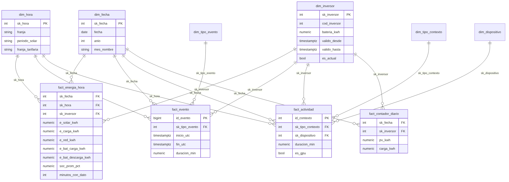

# 3. Modelo dimensional

## 3.1 Elección: estrella (constelación de hechos con dimensiones conformadas)

| Criterio | Estrella (elegida) | Copo de nieve |
|---|---|---|
| Tamaño de las dimensiones | Diminutas (2 inversores, 24 horas, 6 tipos de evento): repetir atributos no cuesta nada | Normalizar ahorraría un espacio que no hace falta |
| Power BI | Es la forma recomendada: un filtro viaja de la dimensión al hecho en una sola dirección | Cadenas de relaciones, más lentas y propensas a ambigüedad |
| Grafana y SQL | Un JOIN por dimensión | JOIN encadenados |

## 3.2 Procesos de negocio y grano

| Proceso | Tabla de hechos | Grano (una fila =) | Tipo | Filas |
|---|---|---|---|---:|
| Balance energético | `fact_energia_hora` | un inversor × una hora local | Periódica (instantánea agregada) | 14 077 |
| Eventos operativos | `fact_evento` | un evento continuo de un tipo en un inversor | Transaccional de intervalos | 880 |
| Actividad y contexto | `fact_actividad` | un registro de contexto (anotación) | Transaccional | 25 178 |
| Contadores del inversor | `fact_contador_diario` | un inversor × un día local | Periódica | 498 |
| Monitoreo en vivo | `fact_lectura_rt` | un inversor × un minuto | Periódica, solo inserción | continuo |

**Por qué el grano horario en Gold:** las preguntas de la dirección son por hora del día, día, mes y periodo; la hora es el nivel más fino que se usa en Power BI y reduce 727 mil filas de Silver a 14 mil (Power BI responde al instante). El detalle por minuto queda en Silver para quien lo necesite.

## 3.3 Dimensiones

| Dimensión | Atributos | Jerarquía | SCD |
|---|---|---|---|
| `dim_fecha` | año, trimestre, mes, semana ISO, día de la semana, fin de semana, estación, temporada de lluvias, con telemetría | Año › Trimestre › Mes › Día | Tipo 0 |
| **`dim_hora`** (construida por el equipo) | hora, franja (madrugada/mañana/tarde/noche), periodo solar (pico/hombro/sin sol), franja tarifaria EPM (punta/fuera de punta) | Franja › Hora | Tipo 0 |
| `dim_inversor` | código, subsistema, capacidad de batería (Ah, kWh, ¿supuesta?), potencia máx. de red, prioridad de carga, SoC de alarma | Subsistema › Inversor | **Tipo 2** |
| `dim_tipo_evento` | código, nombre, categoría, severidad, origen, regla de detección | Categoría › Tipo | Tipo 1 |
| `dim_tipo_contexto` | tipo, fuente, categoría, ¿es carga? | Categoría › Tipo | Tipo 1 |
| `dim_dispositivo` | dispositivo, tipo | Tipo › Dispositivo | Tipo 1 |

Todas tienen un **miembro desconocido** (sk = −1). `dim_hora` no existe en la fuente: la definimos para responder «¿a qué horas dependemos de la red?» y para cruzar con las franjas tarifarias de EPM.

## 3.4 Eventos operativos frente a lecturas

Las **lecturas** son fotografías periódicas del estado (cada ~12 s) y se suman como energía. Los **eventos** (corte de red, batería baja, inversor sin salida, alarma, hueco de datos, apagado manual) son **intervalos con inicio, fin y duración**. Si se dejaran como banderas en cada lectura, un corte de 17 días serían 120 mil filas marcadas y responder «¿cuántos cortes hubo y cuánto duraron?» exigiría reconstruir los intervalos en cada consulta. Por eso:

- se detectan una sola vez en el ETL (minutos consecutivos que cumplen la regla, uniendo separaciones ≤ 5 min);
- se guardan en su propia tabla de hechos con grano «un evento», con su duración como medida aditiva;
- comparten las dimensiones de fecha, hora e inversor con el balance, así se pueden cruzar (energía de la batería durante los cortes).

**Dato inválido ≠ evento.** Una tensión de red de 0 V durante horas, con la batería descargándose en coherencia, **es un evento real** (corte) y se conserva. Una batería en 0 V que a la vez reporta 80 % de carga **es un dato inválido** (físicamente imposible) y se anula.

## 3.5 Matriz de bus

| Proceso \ Dimensión | Fecha | Hora | Inversor | Tipo de evento | Tipo de contexto | Dispositivo |
|---|:-:|:-:|:-:|:-:|:-:|:-:|
| Balance energético | ✔ | ✔ | ✔ | | | |
| Eventos operativos | ✔ | ✔ | ✔ | ✔ | | |
| Actividad y contexto | ✔ | ✔ | ✔ | | ✔ | ✔ |
| Contadores del inversor | ✔ | | ✔ | | | |
| Monitoreo en vivo | (ts) | (ts) | ✔ (código) | | | |

## 3.6 Bonificación: dimensión lentamente cambiante

`dim_inversor` es **SCD tipo 2**. La configuración del inversor cambió de verdad durante el año: el inversor 1 pasó de 0 Ah a **200 Ah** configurados y de 5 600 a 6 200 W de potencia máxima de red (29-ago-2025), y ambos pasaron de prioridad «Solar y red» a **«Solo solar»** (6-ene-2026). Esa configuración explica el comportamiento (por ejemplo, la caída de la compra a la red), así que cada hora debe asociarse a la versión vigente en ese momento; un tipo 1 reescribiría la historia. Versiones que duran menos de 24 h se tratan como ruido de lectura (R18): de 109 339 cambios crudos quedan 5 versiones reales.
