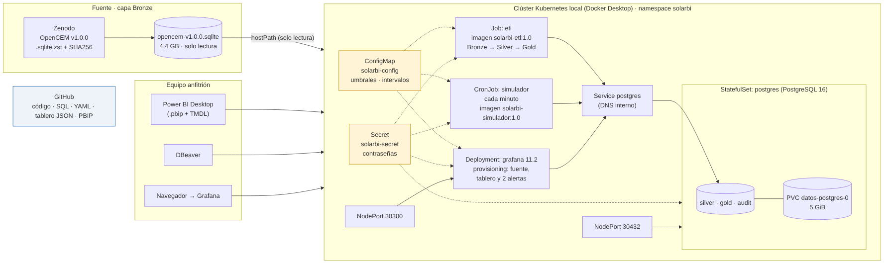

# 7. Arquitectura, comparación de tableros, evolución, ética y seguridad

## 7.1 Arquitectura

| Capa | Componente | Objeto de Kubernetes |
|---|---|---|
| Fuente (Bronze) | `opencem-v1.0.0.sqlite` (Zenodo, CC BY 4.0) | volumen hostPath de solo lectura |
| Integración | ETL Python | Job `etl` |
| Almacenamiento | PostgreSQL 16 (silver, gold, audit) | StatefulSet `postgres` + PVC + Service |
| Streaming | Simulador | CronJob `simulador` |
| Monitoreo | Grafana 11.2 | Deployment `grafana` + Service NodePort |
| Configuración | Umbrales, intervalos / contraseñas | ConfigMap / Secret |
| Análisis | Power BI Desktop, DBeaver | Fuera del clúster, por NodePort 30432 |

## 7.2 Power BI frente a Grafana

| | Power BI | Grafana |
|---|---|---|
| Pregunta | ¿De dónde viene la energía, cuánto ahorramos y en qué conviene invertir? | ¿Algún inversor está sin red o con batería baja **ahora**? |
| Usuario | Dirección de infraestructura, coordinador de energía | Equipo de mantenimiento |
| Datos | Histórico completo (Gold, grano horario) | Últimas horas (`fact_lectura_rt`, grano minuto) |
| Actualización | Importación tras cada corrida del ETL (diaria o mensual) | Cada 30 s, consulta directa a la base |
| Fortalezas | Modelo semántico, DAX, inteligencia de tiempo, what-if, drill-down | Series de tiempo, estado actual, alertas |
| Por qué no se intercambian | No está hecho para refrescar cada pocos segundos ni para avisar a un técnico | No tiene modelo semántico, jerarquías ni comparativos entre periodos cómodos |

## 7.3 Evolución si los datos llegaran directamente de los inversores (Modbus) o de un SCADA

1. Un **gateway** de borde lee los inversores por Modbus RTU/RS485 (o Modbus TCP) cada pocos segundos y publica en **MQTT** (o lo lee un SCADA con OPC UA).
2. El **CronJob simulador se reemplaza** por un **Deployment** consumidor que se suscribe al broker MQTT y escribe en la misma tabla `fact_lectura_rt`. Grafana, las alertas y el modelo no cambian.
3. Con lecturas por segundo, PostgreSQL se extiende con **TimescaleDB** (hypertables y agregados continuos) y la agregación a 1 minuto se hace en la base.
4. El ETL histórico pasa a **incremental**: procesa solo lo nuevo cada noche (CronJob) en lugar de recargar todo.
5. Se agregan un **piranómetro** y la **potencia instalada** para calcular el Performance Ratio, y se fija la cadencia del registrador.
6. En producción: **StatefulSet con réplicas** (operador de PostgreSQL), Ingress con HTTPS y credenciales desde un gestor de secretos.

## 7.4 Ética: la tabla de contexto y la Ley 1581 de 2012

La tabla `context` registra **actividad de personas**: comandos de consola, inicios de sesión remotos, entrenamientos lanzados en estaciones de trabajo y notas del personal. Aunque los autores ya anonimizaron nombres y direcciones, la combinación de horarios y actividad puede **identificar indirectamente** a quien usa una estación (dato personal según la Ley 1581: información vinculable a una persona determinable).

Medidas aplicadas:

- **Minimización (R14):** el ETL elimina del JSON los comandos, rutas de directorios, nombres de archivos y metadatos de origen (12 183 registros). Solo quedan el tipo de actividad, el dispositivo, los núcleos usados y si fue en GPU.
- **Finalidad:** el contexto se usa solo para explicar el **consumo energético** por tipo de carga, nunca para evaluar el desempeño de una persona. No hay ninguna dimensión de persona.
- **Licencia y cita:** los datos son CC BY 4.0; se cita a los autores en el README.
- **Acceso:** Grafana no muestra contexto. En Power BI solo se ven categorías agregadas.

## 7.5 Seguridad de acceso

| Capa | Medida |
|---|---|
| Base de datos | Roles de mínimo privilegio: `etl_admin` (dueño), `bi_lector` (lee gold y audit, y el contexto ya sanitizado), `grafana_ro` (solo gold), `simulador` (solo inserta en `fact_lectura_rt`). Los crea `db/init/00_roles.sh` la primera vez |
| Credenciales en el clúster | Secret generado por Kustomize desde `.env` (excluido de Git). Llegan como variables de entorno (`secretKeyRef`); nunca están en las imágenes, en los manifiestos ni en el tablero exportado. En producción: Secret cifrado en reposo y un gestor (Vault, Sealed Secrets) |
| Grafana | Sin registro libre ni acceso anónimo; administrador con contraseña del Secret; tableros aprovisionados de solo lectura. En producción: rol *Viewer* para mantenimiento y SSO |
| Power BI | Conecta con `bi_lector`; las credenciales quedan en el equipo de cada usuario, no en el `.pbip` |
| Contenedores | Usuario sin privilegios (uid 10001), versiones fijas, límites de CPU y memoria |
| Red | Solo dos NodePort expuestos (30432 y 30300) |
